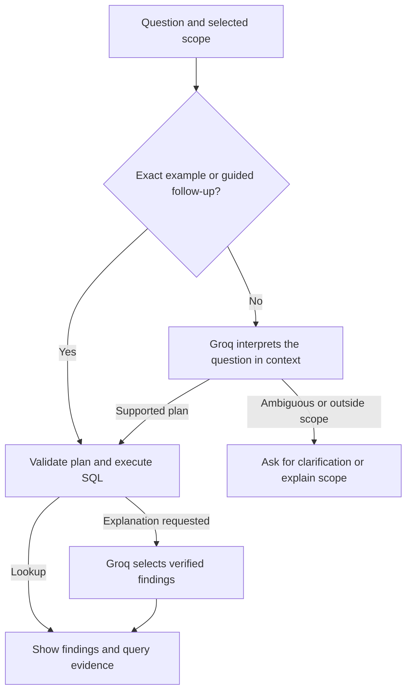

# PaySight AI

PaySight answers questions about payment performance. It calculates metrics in SQLite, breaks changes down by payment method, bank, merchant category and region, and shows the query, dates, filters and aggregate counts behind each finding.

[Open the live app](https://paysight-ai-enterprise-analyst-hu6tqhc5lqxoqe3tm8jyvu.streamlit.app/?embed=true) · [Download the synthetic dataset](data/paysight-payments-v2.zip?raw=true) · [Data dictionary and reproduction instructions](data/README.md)

## Using the app

- **AI analyst** opens first. Ask a question in your own words, choose an example, or narrow a result with a follow-up such as “Only UPI.” Follow-ups retain the previous dates and filters. Each finding includes its supporting data and SQL.
- **Overview** shows payment KPIs, daily trends, segment comparisons and recorded failure reasons. Its data-quality report identifies duplicate attempts, pending payments and missing failure reasons.
- The sidebar supplies the default analysis window. “Last week” means the seven days ending on the selected end date. A question can specify another window. Comparisons use the immediately preceding period of equal length.

## How an answer is produced



Groq receives the question, metric catalog, dates, filters and any prior plan. The application validates the proposed metric, grouping and scope, then compiles a parameterized query. SQLite supplies every number. For explanatory questions, Groq selects and orders verified observations. If the summary call fails, the app presents the SQL findings and their drivers.

SQL runs against a read-only analytical view. Each query has a three-second execution budget and a 500-group limit. Oversized results prompt the user to narrow the request. Explanations distinguish observations from hypotheses, and small-sample warnings show when a few outcomes can materially change a rate.

## Data and attribution

The dataset contains **365 days of synthetic activity** across 48 merchants and four fictional banks. Keeping the first record for each attempt ID removes 24 duplicate copies. Excluding 5,498 pending attempts leaves **358,768 eligible attempts**. The success rate is successful attempts divided by eligible attempts. Successful payment value and average payment value use successful transactions only. The dataset guide includes the CSV schema, generation seeds and an independent calculation of the weekly rates. [Dataset guide](data/README.md)

Within each breakdown, let *p* be a segment’s share of eligible attempts, *r* its success rate and *R* the portfolio rate. Subscripts 0 and 1 denote the previous and current periods. The mix contribution is **(p₁ − p₀)(r₀ − R₀)** and the within-segment contribution is **p₁(r₁ − r₀)**. Together these reconcile to the portfolio change when summed across segments. Each breakdown explains that same change independently. For a segment present in only one period, attribution carries its observed rate across the missing period and assigns the entry or exit effect to mix.

## Run locally

Use Python 3.12. From the repository root, run the commands for your operating system. The first launch builds the seeded SQLite database in the writable `data/` directory.

**Windows PowerShell**

```powershell
py -3.12 -m venv .venv
.\.venv\Scripts\python.exe -m pip install -r requirements.txt
.\.venv\Scripts\python.exe -m streamlit run app.py
```

**macOS or Linux**

```bash
python3.12 -m venv .venv
.venv/bin/python -m pip install -r requirements.txt
.venv/bin/python -m streamlit run app.py
```

**Groq configuration.** Exact examples and guided follow-ups work offline. To enable free-form interpretation and Groq summaries, add the following to Streamlit Cloud **Secrets** or a local `.streamlit/secrets.toml`. The same variables can be set in the server environment.

```toml
GROQ_API_KEY = "<your Groq key>"
GROQ_MODEL = "openai/gpt-oss-20b"
```

**Tests.** Use the virtual environment’s Python with `-m pytest -q`. The suite checks known answers against an independent calculation from raw records, verifies attribution and SQL controls, and exercises the Streamlit workflow. Provider calls in automated tests use fixtures.

**Scope.** PaySight is a single-user prototype with one primary metric per question. The dataset covers payment attempts and outcomes. Production identity, row-level permissions, settlement reconciliation and processor incident logs are outside its scope.
