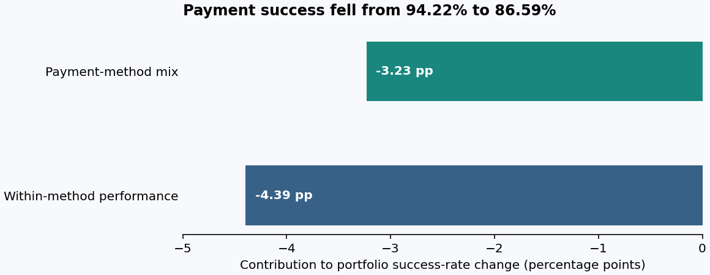
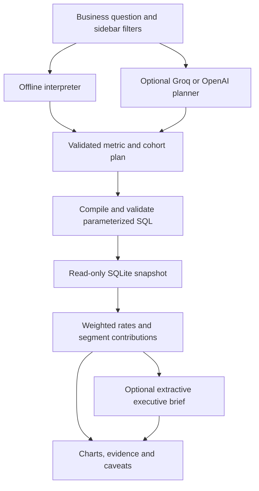

# PaySight AI — Enterprise Payments Intelligence

**Ask your data. Understand your business.** An interactive analyst for a synthetic payments portfolio. Ask why approvals fell, inspect the denominators, compare cohorts and open the exact SQL that supports the answer.



## Run the demo

Use Python 3.12. From the extracted project directory, create an environment and start the application. First launch builds the seeded database automatically and requires write access to the project’s data directory.

**Windows PowerShell**

```powershell
py -3.12 -m venv .venv
.\.venv\Scripts\python.exe -m pip install -r requirements.txt
.\.venv\Scripts\python.exe -m streamlit run app.py
```

**macOS or Linux**

```bash
python3.12 -m venv .venv
.venv/bin/python -m pip install -r requirements.txt
.venv/bin/python -m streamlit run app.py
```

Open the local address printed by Streamlit. Start in **Overview**, then open **AI analyst** and run **“Why did our payment success rate decline last week?”** The default dates reproduce the analysis below. Run the tests from the project root using the same environment's Python and `-m pytest -q`. To build the database separately, run `python -m paysight.data` with that interpreter.

## What the flagship investigation found

| Synthetic portfolio | 2–8 Nov 2026 | 9–15 Nov 2026 |
|---|---:|---:|
| Eligible attempts | 6,744 | 6,980 |
| Successful attempts | 6,354 | 6,044 |
| Success rate | 94.22% | 86.59% |
| Failed attempts | 390 | 936 |

The aggregate change was **−7.63 percentage points**. UPI rose from 1,581 of 6,744 attempts to 3,859 of 6,980. Holding prior method rates fixed, the new distribution accounts for **−3.23 pp**. Changes within methods account for **−4.39 pp**. Displayed components round independently. The exact values reconcile in the test suite.

Viewed by bank, Northstar contributed **−5.49 pp through its within-bank rate change**, weighted by its current share of attempts. This is a second explanation of the same portfolio movement. Adding it to the method contributions would double-count changes. A processor issue is a hypothesis. Comparing Northstar’s authorization and timeout logs across the two windows would help test it.

## Analyst workflow



- **Overview** shows four KPIs, time series, method and bank comparisons, and recorded failure reasons.
- **AI analyst** supports portfolio metrics, rankings, daily trends and equal-window comparisons. Investigations issue five grouped queries for the portfolio and four overlapping breakdowns.
- **Data quality** exposes affected transaction IDs, copy counts, missing reasons, pending attempts and dimension-integrity checks.

SQLite supplies the native read-authorizer and read-only mode in a portable single-file database. Streamlit handles the interface, Plotly draws interactive charts, pandas computes metrics, SQLGlot checks query structure, and pytest exercises the full offline journey.

### Questions to try

| Ask | Result |
|---|---|
| Compare payment success rates for the last two weeks. | Two weighted rates and their percentage-point change |
| Which banks have the lowest success rates? | Bank ranking with eligible attempt counts |
| Show daily transaction volume for the last 30 days. | Daily eligible attempts |
| Compare UPI and credit card performance. | Two method cohorts under identical date filters |
| Which regions have the highest transaction amounts? | Successful INR value by merchant region |
| What are the main drivers of payment failures? | Recorded reason counts, including Unknown where applicable |
| Which merchant categories contribute most to failed transactions? | Failed counts by category |
| What was the average transaction value for Wallet last week? | Successful Wallet value divided by successful Wallet attempts |

The sidebar supplies default dates. “Last week” means the trailing seven dates ending at the selected end date. The synthetic snapshot ends on a Sunday, so the flagship demo compares two full Monday–Sunday weeks. Relative dates are independent of the computer clock. Explicit ISO dates in a question override the sidebar dates. A period comparison uses an adjacent, equally long preceding window. Sidebar and question cohort filters intersect. Inspect the resolved window and filter bindings in **Query evidence**.

### Guided investigations and Groq

Choose **AI analyst** and run the default weekly-decline question. Enter **Only UPI** as a follow-up, then **Which bank contributed most?** The drill-down keeps the dates and filters. For a decline it ranks the most negative total contribution (mix plus within) to the selected cohort. A new business question starts a fresh analysis. Each observed finding opens its supporting aggregate rows, SQL and bound parameters. The data-quality page distinguishes missing reasons in the selected cohort from the snapshot-wide check.

To enable **Groq · assisted**, enter the following in the deployed app’s Streamlit settings under **Secrets**, or in a local, git-ignored `.streamlit/secrets.toml`:

```toml
GROQ_API_KEY = "<your Groq key>"
GROQ_MODEL = "openai/gpt-oss-20b"
```

Server environment variables with the same names also work. Select **Groq · assisted** in the sidebar. Groq receives the question, analytical catalog, allowed filter labels and dates. A model-assisted follow-up also receives the prior plan. A second request can order verified observations for the brief. SQL compilation, execution, numeric calculations and evidence assembly run locally. The bundled follow-up shortcuts resolve locally even in assisted mode. If planning fails, select **Offline · deterministic** and rerun. If only the brief fails, the app displays the verified findings.

### Optional OpenAI mode

Set `OPENAI_API_KEY` in the server process environment, optionally set `OPENAI_MODEL` to a model supporting Chat Completions with JSON output, restart the app, then choose **OpenAI · assisted**. The default model is `gpt-4o-mini`. In PowerShell, use `$env:OPENAI_API_KEY = Read-Host -MaskInput` on PowerShell 7.1+. In Bash use `read -rs OPENAI_API_KEY && export OPENAI_API_KEY`. The example environment file documents variable names. The application reads the process environment directly.

The model receives the question, allowed metrics, cohort labels and dates. It generates a structured plan that drives SQL compilation. A second request receives verified observation sentences and composes an extractive brief by selecting and ordering them. Model output cannot inject new figures into that brief. Invalid plans or service errors are surfaced, and a failed brief preserves the executed observations. No model credentials are needed for the deterministic path. Live model calls require network access and a valid key. Automated model-contract tests use controlled responses.

## Data and definitions

The fixed seed is 412. The 42-day snapshot spans **5 Oct–15 Nov 2026**. All merchants, banks and attempts are synthetic. The generator ships with the repository. The database contains:

| Dataset | Grain and use |
|---|---|
| raw_transactions | Ingested records, including 24 extra copies. Transaction ID, day, bank, merchant, method, status, integer paise and recorded failure reason. |
| merchants | 48 synthetic merchants with category and region. Region always refers to the merchant. |
| banks | Four synthetic institutions joined by integer ID. |
| attempts | One record per transaction ID, retaining the first ingested row. |
| eligible | Joined analytical view restricted to successful and failed attempts. |

Across the snapshot 42,114 raw rows yield 42,090 unique attempts. The 624 pending attempts are excluded. Fifteen failures lack a reason and appear under **Unknown**. The quality page uses the whole snapshot even when the analysis window is narrowed.

| Metric | Definition |
|---|---|
| Volume | Count of unique eligible attempts |
| Successful / failed attempts | Eligible counts for each terminal status |
| Success / failure rate | Corresponding count divided by eligible volume × 100 |
| Gross transaction value | Sum of successful amounts, INR |
| Average transaction value | Successful INR value divided by successful count |

Portfolio rates use pooled counts. No eligible attempts yields an empty-result message. Average successful value is undefined when successful count is zero.

### Attribution method

For segment volume share *p*, success rate *r* in percentage points, and portfolio rate *R*, subscripts 0 and 1 denote previous and current period. PaySight calculates each segment’s mix contribution as **(p₁ − p₀)(r₀ − R₀)** and within contribution as **p₁(r₁ − r₀)**. Centering on R₀ makes gaining share in a below-average segment a negative contribution. Since share changes sum to zero, centering preserves the overall mix effect. Within each breakdown, the sum of both components equals R₁ − R₀. A segment present in only one period carries its observed rate across the missing period for attribution, assigning entry/exit to mix. Its unobserved rate stays blank in the display.

### Execution controls and scope

Only validated plans reach the compiler. Identifiers come from application enums and filter values use SQLite bindings. SQLGlot checks for a single bounded aggregate SELECT over the eligible view. The database opens read-only. A SQLite authorizer restricts tables and functions at execution time. Each scan has a three-second execution budget and a 500-group output cap, above the possible grouped output of the supplied snapshot. Streamlit caches up to 128 analyses. The inspectable result contains the parameterized SQL and the ordered parameter values.

This is a single-user analytical prototype. The app has no production identity system or row-level permissions. The offline interpreter supports a bounded vocabulary and one primary metric per question. Use the examples and filters for predictable scope. Explanations are descriptive. Payment retries, settlement reconciliation, routing decisions, processor logs and external confirmation of incidents are outside the dataset. A production extension would add authenticated policies, versioned source reconciliation and integration with processor incident logs.

## Repository map and verification

| Path | Responsibility |
|---|---|
| app.py | Overview, analyst, quality workspace and evidence panels |
| paysight/data.py | Deterministic data generation, relational schema and quality checks |
| paysight/plans.py, model.py | Metric catalog, language interpretation and optional model integration |
| paysight/query.py, analyst.py | Query construction, validation, bounded execution and attribution |
| tests/ | Raw-data oracle, SQL controls, quality incidents, model contracts and Streamlit UI tests |
| docs/DEMO.md | Four-minute speaking script, recording checklist and publishing commands |

The benchmark oracle independently reads the raw rows, retains first copies, resolves dimension IDs, applies dates and filters, and calculates the expected result in Python. Eleven distinct natural-language questions are checked at group level. Separate tests cover absent cohorts, reproducibility, restricted access, malformed requests and interface behavior. The test fixture verifies planted effects independently of the analyst. All runtime observations come from executed queries.

See [the demonstration guide](docs/DEMO.md) for the recording and publication steps.
