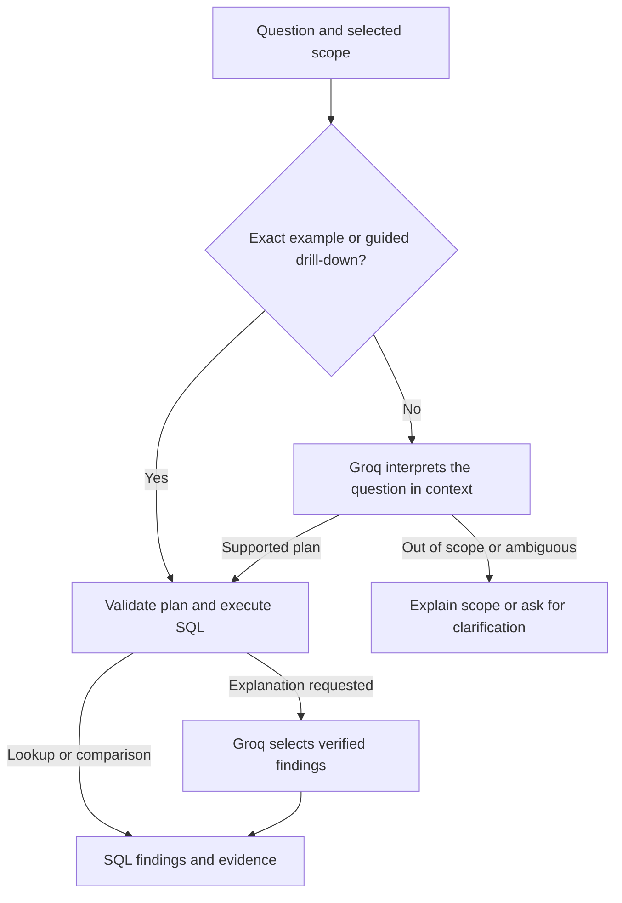

# PaySight AI — Enterprise Payments Intelligence

PaySight analyzes payment performance using natural-language questions. It reports metrics, compares cohorts and links each finding to the SQL and records that support it.

[Open the live application](https://paysight-ai-enterprise-analyst-hu6tqhc5lqxoqe3tm8jyvu.streamlit.app/?embed=true)

**Dataset.** The application uses 364,266 synthetic payment attempts across 48 merchants and four fictional banks, covering 16 November 2025 through 15 November 2026. [Download the three CSVs (ZIP)](https://github.com/subhamghoshkgp/paysight-ai-enterprise-analyst/raw/refs/heads/main/data/paysight-payments-v2.zip) · [Data dictionary, generation method and worked example](data/README.md)

## Run locally

Use Python 3.12. From the project root, create an environment and start the application. First launch builds the seeded database automatically and requires write access to the project’s data directory.

**Windows PowerShell**

```powershell
py -3.12 -m venv .venv
.\.venv\Scripts\python.exe -m pip install -r requirements.txt
.\.venv\Scripts\python.exe -m streamlit run app.py
```

**macOS or Linux**

```bash
python3.12 -m venv .venv
.venv/bin/python -m pip install -r requirements.txt
.venv/bin/python -m streamlit run app.py
```

Open the local address printed by Streamlit. The app opens in **AI analyst**. Run **“Why did our payment success rate decline last week?”** The default dates reproduce the analysis below. Run the tests from the project root using the same environment's Python and `-m pytest -q`. To build the database separately, run `python -m paysight.data` with that interpreter.

## Example investigation: weekly decline in payment success

| Synthetic portfolio | 2–8 Nov 2026 | 9–15 Nov 2026 |
|---|---:|---:|
| Eligible attempts | 6,744 | 6,980 |
| Successful attempts | 6,354 | 6,044 |
| Success rate | 94.22% | 86.59% |
| Failed attempts | 390 | 936 |

The aggregate change was **−7.63 percentage points**. UPI rose from 1,581 of 6,744 attempts to 3,859 of 6,980. Holding prior method rates fixed, the new distribution accounts for **−3.23 pp**. Changes within methods account for **−4.39 pp**. Displayed components round independently. The exact values reconcile in the test suite.

Viewed by bank, Northstar contributed **−5.49 pp through its within-bank rate change**, weighted by its current share of attempts. This is a second explanation of the same portfolio movement. Adding it to the method contributions would double-count changes. Each tab gives a hypothesis and a next step for that breakdown. Cohorts below 30 eligible attempts in either comparison period get a visible caution.

## Analyst workflow



- **Overview** shows four KPIs, time series, method and bank comparisons, and recorded failure reasons.
- **AI analyst** supports portfolio metrics, rankings, daily trends and equal-window comparisons. Investigations issue five grouped queries for the portfolio and four overlapping breakdowns.
- **Overview → Data quality** exposes affected transaction IDs, copy counts, missing reasons, pending attempts and dimension-integrity checks.

SQLite supplies the native read-authorizer and read-only mode in a portable single-file database. Streamlit handles the interface, Plotly draws interactive charts, pandas computes metrics, SQLGlot checks query structure, and pytest exercises the full offline journey.

### Questions to try

| Ask | Result |
|---|---|
| Compare payment success rates for the last two weeks. | Two weighted rates and their percentage-point change |
| Which banks have the lowest success rates? | Bank ranking with eligible attempt counts |
| Show daily transaction volume for the last 30 days. | Daily eligible attempts |
| Compare UPI and credit card performance. | Two method cohorts under identical date filters |
| Which regions have the highest transaction amounts? | Successful INR value by merchant region |
| What are the main drivers of payment failures? | Recorded reason counts, including Unknown where applicable |
| Which merchant categories contribute most to failed transactions? | Failed counts by category |
| What was the average transaction value for Wallet last week? | Successful Wallet value divided by successful Wallet attempts |

The sidebar supplies default dates. “Last week” means the trailing seven dates ending at the selected end date. The synthetic snapshot ends on a Sunday, so the default investigation compares two full Monday–Sunday weeks. Relative dates are independent of the computer clock. Explicit ISO dates in a question override the sidebar dates. A period comparison uses an adjacent, equally long preceding window. Sidebar and question cohort filters intersect. Inspect the resolved window and filter bindings in **Query evidence**.

### Guided investigations and Groq

Choose **AI analyst** and run the default weekly-decline question. Enter **Only UPI** as a follow-up, then **Which bank contributed most?** The drill-down keeps the dates and filters. For a decline it ranks the most negative total contribution (mix plus within) to the selected cohort. A new business question starts a fresh analysis. Each observed finding opens its supporting aggregate rows, SQL and bound parameters. Cohort-specific quality warnings appear with results. The full-snapshot quality report lives under Overview.

To enable automatic Groq explanations, enter the following in the deployed app’s Streamlit settings under **Secrets**, or in a local, git-ignored `.streamlit/secrets.toml`:

```toml
GROQ_API_KEY = "<your Groq key>"
GROQ_MODEL = "openai/gpt-oss-20b"
```

The same settings work as server environment variables. Exact examples and guided drill-downs use local plans. For other questions, Groq receives the question, metric and dimension catalog, dates, selected filters and (for a follow-up) the prior plan. It can propose a structured plan, request clarification or identify a question outside the dataset. The application validates the plan and scope before compiling parameterized SQL. SQL supplies every number. Explanatory questions can use a separate Groq call to select verified observations for the executive summary. Query evidence identifies when Groq interpreted the question. If interpretation is unavailable, use an example; if the summary call fails, the SQL evidence is still available.

Try **Show monthly transaction volume over the full history** to see the entire dataset, or **What was our payment success rate in March 2026?** for one complete calendar month. The first and last calendar months in the full-history chart are partial. The date picker defaults to the final week of the snapshot.

## Data and definitions

The 365-day snapshot spans **16 Nov 2025–15 Nov 2026**. The final six weeks use seed 412. Earlier history uses a separate seed, 413. All merchants, banks and attempts are synthetic. The generator ships with the repository. The database contains:

| Dataset | Grain and use |
|---|---|
| raw_transactions | Ingested records, including 24 extra copies. Transaction ID, day, bank, merchant, method, status, integer paise and recorded failure reason. |
| merchants | 48 synthetic merchants with category and region. Region always refers to the merchant. |
| banks | Four synthetic institutions joined by integer ID. |
| attempts | One record per transaction ID, retaining the first ingested row. |
| eligible | Joined analytical view restricted to successful and failed attempts. |

Across the snapshot 364,290 raw rows yield 364,266 unique attempts. The 5,498 pending attempts are excluded. Fifteen failures lack a reason and appear under **Unknown**. The Overview shows the selected cohort’s missing-reason count alongside the full-snapshot checks.

| Metric | Definition |
|---|---|
| Volume | Count of unique eligible attempts |
| Successful / failed attempts | Eligible counts for each terminal status |
| Success / failure rate | Corresponding count divided by eligible volume × 100 |
| Gross transaction value | Sum of successful amounts, INR |
| Average transaction value | Successful INR value divided by successful count |

Portfolio rates use pooled counts. No eligible attempts yields an empty-result message. Average successful value is undefined when successful count is zero.

### Attribution method

For segment volume share *p*, success rate *r* in percentage points, and portfolio rate *R*, subscripts 0 and 1 denote previous and current period. PaySight calculates each segment’s mix contribution as **(p₁ − p₀)(r₀ − R₀)** and within contribution as **p₁(r₁ − r₀)**. Centering on R₀ makes gaining share in a below-average segment a negative contribution. Since share changes sum to zero, centering preserves the overall mix effect. Within each breakdown, the sum of both components equals R₁ − R₀. A segment present in only one period carries its observed rate across the missing period for attribution, assigning entry/exit to mix. Its unobserved rate stays blank in the display.

### Execution controls and scope

Only validated plans reach the compiler. Identifiers come from application enums and filter values use SQLite bindings. SQLGlot checks for a single bounded aggregate SELECT over the eligible view. The database opens read-only. A SQLite authorizer restricts tables and functions at execution time. Each scan has a three-second execution budget and a 500-group output cap, with an extra row fetched to detect overflow before publishing any partial analysis. Streamlit caches up to 128 SQL analyses. Repeating the last successful request in the same session reuses its result, including its Groq summary. The inspectable result contains the parameterized SQL and the ordered parameter values.

This is a single-user analytical prototype. The app has no production identity system or row-level permissions. Offline mode supports the listed examples and guided follow-ups. Each analysis has one primary metric. Use the examples and filters for predictable scope. Explanations are descriptive. Payment retries, settlement reconciliation, routing decisions, processor logs and external confirmation of incidents are outside the dataset. A production extension would add authenticated policies, versioned source reconciliation and integration with processor incident logs.

## Repository map and verification

| Path | Responsibility |
|---|---|
| app.py | Overview, analyst, quality report and evidence panels |
| paysight/data.py | Deterministic data generation, relational schema and quality checks |
| paysight/plans.py, model.py | Metric catalog, language interpretation and optional model integration |
| paysight/query.py, analyst.py | Query construction, validation, bounded execution and attribution |
| tests/ | Raw-data oracle, SQL controls, quality incidents, model contracts and Streamlit UI tests |

The benchmark oracle independently reads the raw rows, retains first copies, resolves dimension IDs, applies dates and filters, and calculates the expected result in Python. Eleven distinct natural-language questions are checked at group level. Separate tests cover absent cohorts, reproducibility, restricted access, malformed requests and interface behavior. The test fixture verifies planted effects independently of the analyst. All runtime observations come from executed queries.
